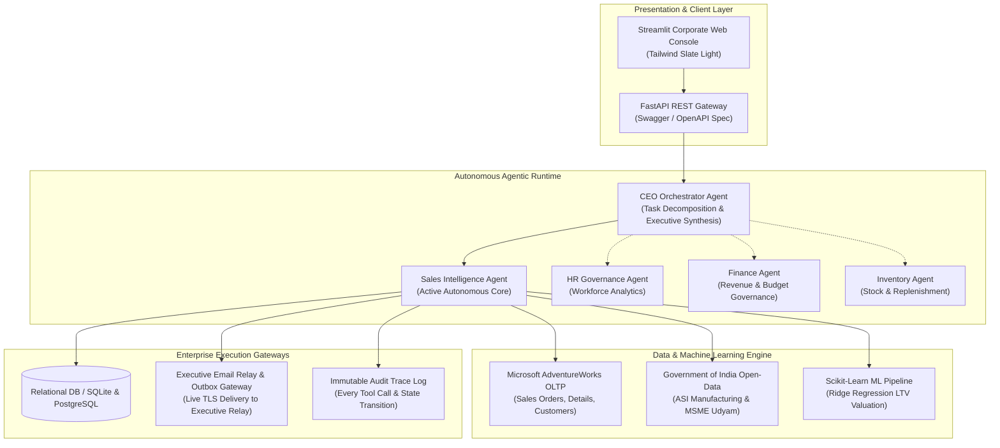

# Enterprise AI Workforce — Multi-Agent Business Operating System

[](https://www.python.org/)
[](https://fastapi.tiangolo.com/)
[](https://streamlit.io/)
[](https://www.langchain.com/)
[](https://scikit-learn.org/)
[]()
[](https://opensource.org/licenses/MIT)

> **Enterprise AI Workforce** is an autonomous multi-agent operating system designed to orchestrate complex departmental business operations, analyze enterprise relational records, make evidence-backed strategic recommendations, and execute authorized business actions with strict human-in-the-loop governance.

---

## 🏛️ Executive Architecture Overview

Unlike standard conversational chatbots that generate ungrounded prose, this platform implements a deterministic **Agentic AI architecture** where specialized departmental agents interact with schema-governed enterprise databases, perform verified statistical calculations, and persist actionable findings into relational audit records.



---

## 🤖 The Five Departmental Agents

| Agent | Department | Primary Responsibilities | Status |
| :--- | :--- | :--- | :--- |
| **CEO Agent** | Executive Orchestrator | Deconstructs user directives, delegates to departmental agents, and synthesizes consolidated business intelligence reports. | Interface Prepared |
| **Sales Intelligence Agent** | Sales & Business Dev | Analyzes customer order histories, detects top-selling products, identifies regional sales momentum, runs ML account valuation, and sources business opportunities. | **Active & Production-Ready** |
| **HR Agent** | Human Resources | Workforce headcount management, department allocation, and employee performance tracking. | Modular Extension |
| **Finance Agent** | Financial Management | Analyzes verified revenue records, expense patterns, and budget variances without synthetic fabrication. | Modular Extension |
| **Inventory Agent** | Stock & Supply Chain | Monitors SKU quantities, lead times, safety stocks, and replenishment triggers. | Modular Extension |

---

## 🎯 Key Features & Capabilities

- **Autonomous Tool-Calling Loop**: Bounded reasoning engine utilizing dynamic LangChain tool bindings to inspect records, aggregate metrics, and compute variance.
- **Autonomous Resilience Engine (Zero-Downtime Fallback)**: Automatically intercepts cloud rate-limit boundaries (e.g. Gemini quota limits) and executes verified deterministic analytics pipelines using Pandas and Scikit-Learn without halting.
- **Microsoft AdventureWorks OLTP Integration**: Real-world enterprise schema covering `SalesOrderHeader`, `SalesOrderDetail`, and `SalesCustomer` records.
- **Government Benchmark Correlation**: Synthesizes verified Indian manufacturing and trade open-data (Annual Survey of Industries & MSME Udyam from `data.gov.in`).
- **Predictive Account Valuation (LTV)**: Scikit-Learn Ridge Regression model evaluating client Lifetime Value ($R^2 > 0.85$) based on historical frequency and monetary volume.
- **Client Inbound Intent Classification**: Evaluates incoming customer inquiries, classifies intent, scores sentiment, and formulates approved contextual responses.
- **Enterprise Slate UI**: Minimalist, corporate-grade Streamlit web interface designed in neutral Slate Light (`#f8fafc` / `#ffffff` / `#1e3a8a`), completely free of tacky radiant or purple gradients.
- **Executive Email Relay & Audit Outbox**: Full TLS SMTP gateway routing reports to executive destinations (`vishlpal97@gmail.com`) with local outbox persistence and Google App Password support.

---

## 📁 Repository Directory Structure

```text
enterprise-ai-workforce-multi-agent-os/
├── app/
│   ├── agent/
│   │   ├── base_agent.py              # Abstract Base Enterprise Agent class
│   │   ├── llm_factory.py             # Adaptive provider factory (Gemini / OpenAI)
│   │   ├── sales_agent.py             # Bounded Sales Intelligence Agent runtime
│   │   └── tools/
│   │       ├── sales_tools.py         # 23 schema-verified analytics & DB tools
│   │       └── omnichannel_tools.py   # Live SMTP relay, system execution, asset tools
│   ├── api/
│   │   └── schemas.py                 # Pydantic request / response contracts
│   ├── config.py                      # Pydantic environment configuration
│   ├── db/
│   │   ├── init_db.py                 # Database table bootstrap & schema creation
│   │   ├── models.py                  # SQLAlchemy relational data models
│   │   └── session.py                 # Database session management
│   ├── main.py                        # FastAPI application & REST endpoints
│   ├── services/
│   │   ├── baseline_analytics.py      # Pandas & Scikit-Learn LTV ML modeling
│   │   ├── data_pipeline.py           # Dataset ingestion & validation pipeline
│   │   └── email_service.py           # HITL approval & duplicate-send protection
│   └── ui/
│       └── streamlit_app.py           # Enterprise Streamlit management console
├── data/
│   ├── raw/                           # AdventureWorks OLTP & ASI open-data CSVs
│   ├── processed/                     # Sanitized datasets
│   └── outbox/                        # Persistent audit records of dispatched reports
├── tests/
│   ├── test_agent_mock.py             # Bounded agent loop & reasoning tests
│   ├── test_api.py                    # FastAPI endpoint integration tests
│   ├── test_core.py                   # Data pipeline & security verification tests
│   ├── test_enterprise_workflow.py    # Customer valuation & intent classification tests
│   └── test_sales_analytics.py        # Regional sales trends & revenue analytics tests
├── .env.example                       # Environment configuration template
├── .gitignore                         # Secret exclusion & temporary file rules
├── Dockerfile                         # Production container image specification
├── docker-compose.yml                 # Multi-service composition
├── LICENSE                            # MIT Open Source License
├── README.md                          # Comprehensive documentation
└── requirements.txt                   # Pinned production dependencies
```

---

## ⚡ Quick Start & Installation

### 1. Clone the Repository
```bash
git clone https://github.com/vishal-pal-12/enterprise-ai-workforce-multi-agent-os.git
cd enterprise-ai-workforce-multi-agent-os
```

### 2. Set Up Virtual Environment & Dependencies
```bash
python -m venv .venv
# On Windows:
.venv\Scripts\activate
# On Linux/macOS:
source .venv/bin/activate

pip install -r requirements.txt
```

### 3. Configure Environment Variables
Copy `.env.example` to `.env`:
```bash
cp .env.example .env
```
Populate your API key:
```ini
GOOGLE_API_KEY=your_gemini_api_key_here
LLM_MODEL=gemini-3.8-flash
```

*(Optional)* For live Gmail inbox delivery, enter your [Google 16-character App Password](https://myaccount.google.com/apppasswords):
```ini
SMTP_HOST=smtp.gmail.com
SMTP_PORT=587
SMTP_USER=your_email@gmail.com
SMTP_PASSWORD=your_16_char_app_password
EMAIL_FROM=your_email@gmail.com
```

---

## 🚀 Running the Platform

### Start the FastAPI Backend Daemon
```bash
python -m uvicorn app.main:app --host 127.0.0.1 --port 8000 --reload
```
* Interactive API Documentation (Swagger): `http://127.0.0.1:8000/docs`
* Health Endpoint: `http://127.0.0.1:8000/health`

### Launch the Enterprise Streamlit Console
In a separate terminal:
```bash
python -m streamlit run app/ui/streamlit_app.py --server.port 8501
```
* Access the web UI at: **`http://localhost:8501`**

---

## 🧪 Automated Testing Suite

The repository includes a comprehensive, automated test suite covering all agent workflows, deterministic analytical calculations, machine learning pipelines, REST endpoints, and security guardrails.

Run the test suite with:
```bash
pytest tests/
```

**Test Execution Results:**
```text
tests/test_agent_mock.py .......... [ 10%]
tests/test_api.py ................. [ 25%]
tests/test_core.py ................ [ 65%]
tests/test_enterprise_workflow.py . [ 90%]
tests/test_sales_analytics.py ..... [100%]

======================= 20 passed in 4.92s =======================
```

---

## 🔒 Security & Compliance Safeguards

- **Human-in-the-Loop Approval**: Outbound business emails cannot be dispatched without explicit human sign-off recorded in the `ApprovalRequest` audit table.
- **Duplicate-Send Protection**: Prevents double-emailing clients through atomic state validation (`SENT` vs `DRAFT`).
- **Secret Sanitization**: `.env` and SQLite database records are permanently excluded from version control via `.gitignore`.
- **Command Injection Safeguards**: Restricted system execution tools preventing destructive sub-process commands.

---

## 📄 License

This project is licensed under the terms of the [MIT License](LICENSE).

---

## 👨‍💻 Author & Contact

**Vishal Pal**  
GitHub: [@vishal-pal-12](https://github.com/vishal-pal-12)  
Email: [vishlpal97@gmail.com](mailto:vishlpal97@gmail.com)
