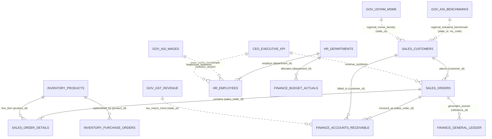

# Multi-Agent Enterprise Relational Schema & ER Diagram

This document illustrates the complete relational database architecture and boundary mappings for the **AI-Powered Multi-Agent Enterprise Automation System**, combining **Microsoft AdventureWorks OLTP** for enterprise operational tables with official **Government Open Data (data.gov.in / MOSPI ASI)** for macroeconomic and industrial benchmarks.

---

## 1. Entity-Relationship (ER) Architecture

---

## 2. Agent Domain Responsibility & Table Ownership

| Agent Name | Schema / Namespace | Owned Relational Tables | External Benchmark Joins |
| :--- | :--- | :--- | :--- |
| **CEO Orchestrator** | `ceo.*` | `executive_kpi_summary`, `strategic_initiatives` | `asi_state_economic_health_index` (MOSPI ASI) |
| **Sales Agent** | `sales.*` | `customers`, `orders`, `order_details` | `gov_udyam_msme_b2b_market_opportunity`, `gov_dgcis_commodity_export_demand` |
| **HR Talent Agent** | `hr.*` | `departments`, `employees` | `gov_asi_manufacturing_wage_benchmarks`, `gov_plfs_labour_productivity_rates` |
| **Finance Agent** | `finance.*` | `general_ledger`, `accounts_receivable`, `budget_vs_actuals` | `gov_gst_state_revenue_trends` |
| **Inventory Agent** | `inventory.*` | `products`, `purchase_orders`, `warehouse_movements` | `gov_asi_industrial_input_costs` |

---

## 3. Referential Integrity Rules

1. **Order to Customer Integrity**:
   - `sales.orders(customer_id)` $\to$ `sales.customers(customer_id)`
   - Every sales order must be linked to a pre-existing enterprise account.
2. **Line Item to Order Integrity**:
   - `sales.order_details(sales_order_id)` $\to$ `sales.orders(sales_order_id)` (Cascade on delete).
3. **Line Item to Catalog Product Integrity**:
   - `sales.order_details(product_id)` $\to$ `inventory.products(product_id)`.
4. **Employee to Department Integrity**:
   - `hr.employees(department_id)` $\to$ `hr.departments(department_id)` (Restricted on delete).
5. **Invoice & Accounts Receivable Integrity**:
   - `finance.accounts_receivable(sales_order_id)` $\to$ `sales.orders(sales_order_id)`
   - `finance.accounts_receivable(customer_id)` $\to$ `sales.customers(customer_id)`.
6. **Government Benchmark Correlation**:
   - `sales.customers(state_ut)` maps to `gov_benchmarks.asi_manufacturing_statistics(state_ut)` and `gov_benchmarks.udyam_msme_registered_units(state_ut)`.
   - `sales.customers(nic_2digit_code)` maps to `gov_benchmarks.asi_manufacturing_statistics(nic_2digit_code)`.

